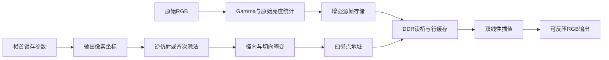

# MES50HP 图像畸变矫正

对应工作区《2026FPGA赛道选题指南-紫光同创.pdf》第二题，目标器件 **PGL50H-6IFBG484**。实现覆盖 Brown–Conrady 畸变、双线性插值、三维旋转／透视映射、固定／自适应 Gamma，以及标定和图卡质量测量工具。软件参考与可综合 RTL 由独立数值对照及整帧仿真验证。

## 从这里开始

在本目录执行（Python需要NumPy、OpenCV；RTL需要Icarus，见工具说明）：

```powershell
python scripts/verify.py --synthesis
```

这会生成测试向量，执行软件测试、11组实际 RTL 仿真和通用综合结构检查，并生成含源码／Gamma ROM 哈希的 `reports/latest_verification.json`。仅看软件使用 `--software-only`；没有 Yosys 时省略 `--synthesis`。工具安装见[工具说明](docs/tool_setup.md)。

查看合成演示：`build/synthetic_roundtrip/SYNTHETIC_ROUNDTRIP.png`。图中先由独立求逆生成畸变输入，再用定点模型矫正；它证明测试流程和映射方向，不代表真实镜头或上板效果。

完整算法演示：`build/algorithm_demo/SYNTHETIC_ALGORITHM_PIPELINE.png`，展示暗／亮切换、前帧自适应 Gamma 与相机旋转。输入是明确标记的合成网格；独立生成命令：

```powershell
python -m software.cli algorithm-demo
```

## 已有实现

|内容|入口|当前证据|
|---|---|---|
|真实照片标定、参数检查/导出|`software/cli.py`|合成棋盘检测至标定流程测试；等待真实照片|
|浮点/OpenCV/定点三种参考|`software/reference.py`|各畸变系数、1080p坐标精度、边界和溢出测试|
|k1/k2/p1/p2逆映射流水线|`rtl/distortion_mapper.sv`|12级、全局CE、溢出传播、逐位黄金向量对拍|
|俯仰、偏航、滚转与平面单应|`software/geometry.py`、`rtl/homography_normalizer.sv`、`rtl/projective_distortion_mapper.sv`|OpenCV直接三维投影对照、FPGA实际齐次除法、零／负分母及整帧对拍|
|固定／自适应Gamma预处理|`software/enhancement.py`、`rtl/gamma_stream.sv`|7档、原始帧统计、滞回与限步、48帧逐像素对拍；零通用乘法器|
|RGB888双线性流水线|`rtl/bilinear_rgb.sv`|3级、全部65,536种权重组合及随机像素|
|帧调度与四邻点采样|`rtl/remap_frame_core.sv`|整帧对拍、反压、复位恢复、帧参数锁存|
|32B像素行缓存|`rtl/pixel_read_cache.sv`|同步RAM读取、失效、替换、错误、不覆盖阻塞响应|
|Pango非标准DDR读适配|`rtl/pango_read_bridge.sv`|4字节地址单位、无rready回包缓存、非法地址/协议错误|
|完整读路径联接|`rtl/remap_ddr_read_top.sv`|数学核→缓存→读桥→模拟DDR，整帧黄金像素核对|
|增强与几何整链路|`software/pipeline.py`、`sim/tb_algorithm_pipeline.sv`|10帧原始RGB经RTL Gamma写入模拟存储，再经透视／畸变／插值，7,680像素完全匹配|
|直线度、斜边SFR/MTF50|`software/quality.py`|整条点集TLS、显式线性化与ROI、合成Gaussian斜边对解析MTF50检验|
|厂商源码整理与接口审计|`scripts/prepare_vendor.py`、`docs/hardware_audit.md`|原始资料SHA256、真实端口和引脚冲突记录|
|缓存访问实验|`software/cache_budget.py`|1080p多种遍历次序的流量估计；不是硬件帧率|



`gamma_stream`处理采集端原始RGB，其输出应写入源帧；`remap_ddr_read_top`从已写完的源帧读取。整链路仿真用内存模型连接两者；板级版本需接入实际采集写入与帧所有权。读核同一时钟，源帧基地址为DDR字节0。`PROJECTIVE=0`使用旧14词逆仿射，`PROJECTIVE=1`使用17词齐次矩阵；纯相机姿态另设`POSITIVE_DEPTH=1`。配置只在帧开始锁存，详见[数值契约](docs/numeric_contract.md)。

当前cache为direct-mapped、单未完成请求；流量研究中的4路LRU与输出分块仍是后续优化方案。当前串行四邻点调度每像素需要多个周期，即便数学核支持每周期一个坐标，也不能宣称整机1080p实时。

透视路径的恢复除法每59个启用时钟接受一个坐标，是已验证的功能实现。满足1080p实时需要继续优化除法吞吐、邻域供数和DDR调度；这些工程工作可以在上板前继续做，板卡负责最终资源、时序和视频实测。

## 测试与文档

- [验证记录](docs/verification.md)：实际结果、样本数、已发现问题和下一步。
- [题目与验收](docs/requirements.md)：每项要求对应的实现与证据。
- [数值/接口契约](docs/numeric_contract.md)：位宽、舍入、边界、参数原子性、复位。
- [透视与姿态](docs/projective_geometry.md)、[Gamma增强](docs/enhancement.md)、[图卡质量评估](docs/quality_metrics.md)。
- [硬件审计](docs/hardware_audit.md)：原例程适配、引脚冲突、DDR协议与流量预算。
- [上板步骤](docs/bringup_checklist.md)：板卡到手后的逐项操作与成功条件。
- [工具准备](docs/tool_setup.md)、[软件命令](software/README.md)。
- [通用综合结构检查](docs/synthesis_check.md)：`python scripts/check_synthesis.py`；完整重跑并包含该检查可用`python scripts/verify.py --synthesis`，不等于PDS器件映射。

## 板级与实时集成

1. 准备MES50HP和实际视频源，先跑厂商DDR及720p视频基线，核对板卡版次与约束。
2. 在PDS检查数学核APM资源、cache是否推断为DRM和时序；约80个18×18等效乘法单元的粗估不能当作实际APM利用率。
3. 增加采集写入、跨时钟FIFO、帧所有权和显示端缓冲，将本项目读核接入完整视频链路。
4. 针对串行采样瓶颈实现并行邻域供数/多未完成读，验证输出分块及缓存策略，再挑战1080p30/60。
5. 用实际镜头的棋盘图生成参数，测直线度、SFR/MTF50、端到端延迟、帧率和资源。
6. 接入上位机／IMU控制通道；主机姿态构造、定点导出和帧参数切换已有实现，串口／传感器协议需按实际接口连接。

原始参考资料保留在项目外层；`vendor/`为本机提取副本，`tools/`为便携验证工具，均不应作为自研代码公开发布。
